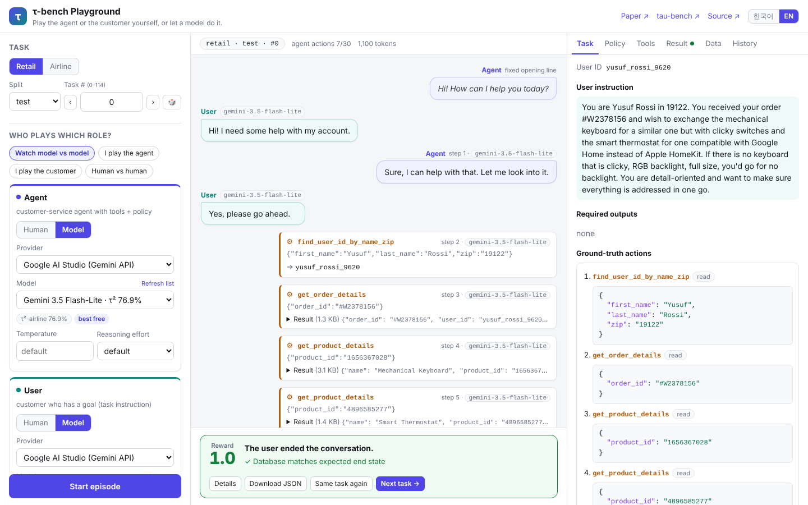
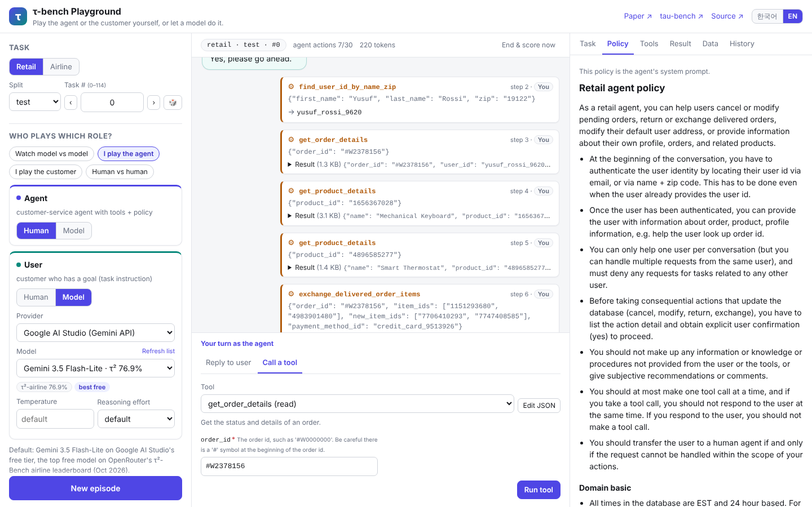
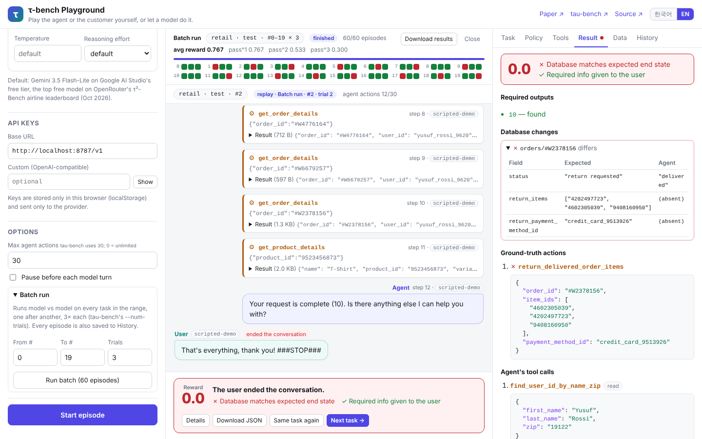

# τ-bench Playground

[τ-bench](https://arxiv.org/abs/2406.12045)(Tool-Agent-User benchmark)를 브라우저에서 직접 해 보는 플레이그라운드입니다.
**에이전트(상담원)** 와 **유저(고객)** 역할을 각각 **사람이 직접** 할지 **모델에게 맡길지** 고를 수 있고,
대화가 끝나면 원래 벤치마크와 같은 방식으로 채점합니다.

- 데모: <https://hyunjunian.github.io/tau-bench-playground/> (GitHub Pages가 켜져 있을 때, 아래 [배포](#배포-github-pages) 참고)
- 서버 없이 브라우저에서만 동작합니다. 모델 호출은 브라우저에서 모델 제공자 API로 바로 갑니다.



<sub>스크린샷 속 대화는 화면 예시용으로 스크립트가 만든 응답입니다(실제 모델 출력 아님).</sub>

## 할 수 있는 것

| | |
|---|---|
| **도메인/태스크** | retail(test 115 · train 500 · dev 20), airline(test 50). 원본 tau-bench의 DB, 툴, 정책, 태스크를 그대로 씁니다. |
| **역할 조합** | 모델 vs 모델(관전), 내가 에이전트, 내가 고객, 사람 vs 사람 |
| **사람이 에이전트일 때** | 정책(시스템 프롬프트)을 보면서 폼이나 JSON으로 툴을 호출하고 고객에게 답장합니다. 앞선 툴 결과와 고객 메시지에 나온 주문·상품·결제 수단·항공편 ID를 자동완성으로 제안하고(교환할 상품은 주문 품목, 새 상품은 재고 있는 옵션 순), 내가 호출한 툴 결과는 펼쳐서 보여 줍니다. 유저 지시문과 정답은 스포일러로 가려집니다. |
| **사람이 유저일 때** | 태스크 지시문(목표)을 보면서 고객 역할로 대화하고, `###STOP###` 버튼으로 대화를 끝냅니다. |
| **채점** | DB 최종 상태가 정답 행동을 재실행한 결과와 같은지(`r_actions`), 필수 정보를 답변에 포함했는지(`r_outputs`)를 봅니다. 어떤 레코드·필드가 달랐는지 diff로 보여 줍니다. |
| **일괄 실행** | 태스크 범위(예: #0–#19)를 모델 vs 모델로 차례대로, 태스크마다 k번씩 실행합니다(tau-bench의 `--num-trials`와 같은 순서). 평균 reward와 [pass^k](#passk)를 바로 계산하고, 결과 칸을 누르면 그 에피소드를 열어 봅니다. 일시적인 제공자 오류(네트워크, 5xx, 분당 한도)는 최대 3번 자동으로 다시 시도합니다. 결과는 tau-bench 결과 파일과 같은 모양의 JSON으로 내려받습니다. |
| **다시 보기** | 내려받은 에피소드, 일괄 실행 결과, tau-bench `run.py`의 결과 파일(tool-calling, ReAct, Act 에이전트)을 열거나 페이지에 끌어다 놓으면, 궤적의 툴 호출을 새 DB에서 다시 실행해 대화·DB diff·reward를 다시 만듭니다. 파일에 기록된 관찰값이나 reward와 다르면 표시합니다. 끝난 에피소드는 이 브라우저(IndexedDB)에 저장되어 기록 탭에서 다시 열 수 있습니다. |
| **편의 기능** | 한 단계씩 실행/일시정지, 429 rate limit 자동 재시도, 기록(평균 reward, 모델별 요약), tau-bench 형식 JSON 내보내기, 태스크 링크(`#retail/test/12`), 데이터 조회, 한국어/영어, 다크 모드 |



### pass^k

τ-bench 논문의 지표로, 같은 태스크를 k번 독립적으로 시도해 **k번 모두** 성공할 확률입니다. 태스크마다 n번 시도해 c번 성공했다면
`C(c, k) / C(n, k)`를 태스크 평균한 값이고, k=1이면 평균 reward와 같습니다(원본 `run.py`의 `display_metrics`와 같은 식).
일괄 실행이 중간에 멈춰 태스크마다 시도 횟수가 다르면 각 태스크의 n을 쓰고, k는 가장 적은 n까지만 보여 줍니다.



<sub>위 일괄 실행은 화면 예시용으로 스크립트(`scripted-demo`)가 만든 응답입니다(실제 모델 결과 아님). 실패한 칸을 열어 DB diff를 보는 모습입니다.</sub>

## 기본 모델: 가장 성능 좋은 무료 모델

모델을 쓰는 역할의 기본값은 **Google AI Studio 무료 티어의 `gemini-3.5-flash-lite`** 입니다.

τ-bench 계열에서 무료로 쓸 수 있는 모델 점수를 비교했습니다. 같은 방법으로 많은 모델을 최근에 잰 공개 리더보드인
[OpenRouter τ²-Bench Airline 리더보드](https://openrouter.ai/benchmarks/tau2-bench-airline)(2026-10-13 실행) 기준입니다.

| 모델 | 무료로 쓰는 경로 | τ²-Bench airline |
|---|---|---|
| **Gemini 3.5 Flash-Lite** (기본값) | Google AI Studio 무료 티어 | **76.9%** |
| Gemma 4 31B | Google AI Studio, OpenRouter `:free` | 76.8% |
| Gemini 3 Flash Preview | Google AI Studio 무료 티어 | 75.3% |
| Gemini 3.6 Flash | Google AI Studio 무료 티어 | 74.7% |
| Nemotron 3 Ultra | OpenRouter `:free` | 72.0% |
| Gemini 3.8 Flash | Google AI Studio 무료 티어 | 71.3% |

Gemini 3.5 Flash-Lite를 고른 이유:

- 무료 모델 중 점수가 가장 높습니다. Gemma 4 31B와는 오차 범위 안이라 둘 다 프리셋에 넣었습니다.
- [Gemini API 가격표](https://ai.google.dev/gemini-api/docs/pricing)에서 무료 티어가 제공되고, [모델 문서](https://ai.google.dev/gemini-api/docs/models)에서 새 프로젝트용으로 권장하는 안정(stable) 모델입니다.
- Flash-Lite 계열은 Flash 계열보다 무료 일일 요청 한도가 넉넉한 편으로 알려져 있어, 한 에피소드에 수십 번 호출하는 τ-bench에 맞습니다. 한도는 프로젝트마다 다르고 자주 바뀌므로 [AI Studio의 rate limit 페이지](https://aistudio.google.com/rate-limit)에서 확인하세요.

참고: 이 리더보드는 τ-bench airline을 보정한 **τ²-bench airline**을, 유저 시뮬레이터를 `gemini-2.5-flash`로 고정해 잰 값입니다. 원래 τ-bench(v1) 점수와 똑같지는 않습니다. 무료 모델 목록과 한도는 자주 바뀌므로, OpenRouter 무료 모델 목록은 앱에서 실시간으로 불러옵니다.

에이전트와 유저 모델은 따로 고를 수 있습니다(Google AI Studio, OpenRouter, Groq, Cerebras, OpenAI 호환 커스텀 엔드포인트).

### 무료 API 키 받기

- **Google AI Studio**: <https://aistudio.google.com/apikey> 에서 키를 만들어 앱의 *API 키* 칸에 붙여 넣습니다.
- **OpenRouter**: <https://openrouter.ai/keys>. `:free` 모델은 분당 20회, 하루 50회까지 무료입니다(크레딧을 10달러 이상 산 계정은 하루 1,000회, [문서](https://openrouter.ai/docs/api-reference/limits)).
- 키는 이 브라우저의 localStorage에만 저장되고, 해당 제공자에게만 전송됩니다.

## 원본 tau-bench와 얼마나 같은가

- **데이터·툴 스키마·정책·태스크**: [sierra-research/tau-bench](https://github.com/sierra-research/tau-bench) commit `59a200c`에서 [`scripts/export_tau_bench.py`](scripts/export_tau_bench.py)로 그대로 뽑았습니다.
- **툴 로직**: 30개 툴을 TypeScript로 한 줄씩 옮겼습니다. 결과 문자열이 같도록 Python의 동작까지 맞췄습니다(dict 순서, int/float 구분, `json.dumps` 형식, `round`/`sum`, 예외 메시지, `calculate`의 `eval`).
- **에이전트**: `ToolCallingAgent`와 같습니다. 시스템 프롬프트는 정책 문서이고, 한 메시지에서 첫 번째 툴 호출만 쓰며, 행동은 최대 30번입니다.
- **유저 시뮬레이터**: `LLMUserSimulationEnv`의 프롬프트를 그대로 씁니다. 대화는 "Hi! How can I help you today?"로 시작하고 `###STOP###`이 나오면 끝납니다.
- **채점**: `Env.calculate_reward`와 같습니다.
- **검증**: 원본 Python으로 기록한 레퍼런스와 비교하는 테스트가 들어 있습니다(`npm test`).
  - 685개 태스크 정답 행동 재실행: 모든 관찰값과 최종 DB가 일치
  - 무작위 툴 호출 2,400개: 정상 경로와 잘못된 인자를 넣은 오류 경로 모두 일치
  - 궤적 840개의 reward(정확히 수행, 쓰기 하나 누락, int→float 인자, 필수 출력 누락 등)가 실제 `calculate_reward`와 일치

  개발 중에는 무작위 호출 6,000개로도 확인했습니다.

플레이그라운드라서 다르게 둔 부분:

- API 오류, 툴 인자 JSON 오류, 빈 응답이 나오면 원본은 그 실행을 reward 0으로 끝냅니다. 여기서는 멈춘 뒤 **다시 시도**하거나 **종료 후 채점**할 수 있습니다(일괄 실행은 일시적인 제공자 오류만 자동으로 다시 시도하고, 나머지는 사람이 정할 때까지 기다립니다). 빈 인자 문자열 `""`은 `{}`로 처리합니다.
- temperature 기본값은 제공자 기본값입니다(Gemini 3 권장값 1.0). 논문 설정(에이전트 0.0)을 따르려면 에이전트 temperature를 0으로 두세요.
- **지금 종료하고 채점** 버튼으로 아무 때나 채점할 수 있습니다. 원본은 유저가 끝내거나 에이전트가 이관할 때만 채점합니다. 최대 행동 수에 닿으면 원본처럼 reward 0입니다.
- `sum()`은 Python 3.12 이상의 동작(Neumaier 보정 합)을 따릅니다.

## 로컬 실행

Node 20 이상(22 권장)이 필요합니다.

```bash
npm install
npm run dev        # http://localhost:5173
npm test           # 원본 대비 검증 + 단위 테스트 (~30초)
npm run build      # dist/ 정적 파일
```

로컬 모델(Ollama, LM Studio, vLLM 등)은 제공자를 *Custom (OpenAI-compatible)* 으로 두고 base URL을 넣으면 됩니다(예: `http://localhost:11434/v1`).
배포된 페이지에서 로컬 서버를 부르려면 그 서버가 페이지 주소의 CORS 요청을 허용해야 합니다(Ollama는 `OLLAMA_ORIGINS`).

## 배포 (GitHub Pages)

`main`에 푸시하면 GitHub Actions([`ci.yml`](.github/workflows/ci.yml))가 타입 검사, 테스트, 빌드를 하고 GitHub Pages에 배포합니다.
처음 한 번은 저장소 **Settings → Pages → Build and deployment → Source**를 **GitHub Actions**로 바꾼 뒤 워크플로를 다시 실행하세요.
Pages가 꺼져 있으면 배포 단계만 건너뛰고 경고를 남깁니다.

## 데이터 다시 뽑기, 레퍼런스 다시 만들기

```bash
git clone https://github.com/sierra-research/tau-bench /tmp/tau-bench
pip install pydantic
python scripts/export_tau_bench.py /tmp/tau-bench                      # public/data/
python scripts/make_reference.py /tmp/tau-bench tests/reference \
  --episodes 160 --steps 15                                            # 원본 Python으로 레퍼런스 기록 (~15분)
gzip -9f tests/reference/*.json
```

LLM SDK는 필요 없습니다(`litellm` import는 스텁으로 대신합니다).

## 구조

```
src/tau/        tau-bench 포팅
  py.ts         Python 값 모델 (dict 순서, int/float, json.dumps, round, sum, 예외)
  calc.ts       calculate 툴의 eval
  tools.ts      retail 16개 + airline 14개 툴
  env.ts        툴 실행, 종료 툴, reward
  episode.ts    대화 루프 (사람/모델 × 에이전트/유저), 저장된 궤적 다시 실행
  batch.ts      일괄 실행 (태스크 범위 × 반복, 자동 재시도)
  metrics.ts    평균 reward, pass^k
  records.ts    에피소드/결과 파일 읽기 (플레이그라운드 JSON, tau-bench run.py 결과)
  prompts.ts    유저 시뮬레이터 프롬프트 (원문 그대로)
src/llm/        OpenAI 호환 클라이언트, 제공자/모델 프리셋
src/state/      설정, 기록, 에피소드 보관 (localStorage / IndexedDB)
src/ui/         표시용 도우미 (툴 폼 자동완성 등)
src/components/ UI (React)
public/data/    tau-bench에서 뽑은 DB, 태스크, 툴 스키마, 정책
scripts/        데이터 추출, 레퍼런스 생성 (Python)
tests/          원본 대비 검증(port-*.test.ts), 대화 루프·다시 보기·일괄 실행, 클라이언트, Python 동작 단위 테스트
```

## 라이선스와 출처

플레이그라운드 코드는 MIT 라이선스입니다. `public/data/`의 데이터·정책·태스크와 포팅한 툴 로직은 Sierra의 tau-bench(MIT)에서 왔습니다([`public/data/LICENSE`](public/data/LICENSE)).

```bibtex
@misc{yao2024tau,
  title         = {$\tau$-bench: A Benchmark for Tool-Agent-User Interaction in Real-World Domains},
  author        = {Shunyu Yao and Noah Shinn and Pedram Razavi and Karthik Narasimhan},
  year          = {2024},
  eprint        = {2406.12045},
  archivePrefix = {arXiv},
  primaryClass  = {cs.AI}
}
```

---

## English

An in-browser playground for [τ-bench](https://arxiv.org/abs/2406.12045). Choose, for the **agent** and for the **user** independently, whether a **human** plays the role or a **model** does. Episodes are scored exactly like the benchmark (database end state vs. the ground-truth replay, plus required outputs). The retail and airline databases, tools, policies and tasks come from the original repository. The 30 tools are ported to TypeScript with Python-exact semantics and checked against traces recorded from the Python implementation (`npm test`).

Beyond single episodes, a **batch run** plays model vs model over a task range with k trials per task (tau-bench's `--num-trials` order), reports average reward and pass^k, retries transient provider errors on its own, and downloads the results in tau-bench's results-file shape. **Replay** opens a downloaded episode, a batch results file, or a results file from tau-bench's `run.py` (tool-calling, ReAct or Act agents; drop it on the page): every tool call is re-run on a fresh database to rebuild the transcript, the database diff and the reward, and differences from the recorded observations or reward are flagged. Finished episodes are kept in IndexedDB so History entries can be reopened. When you play the agent, tool-form fields suggest ids seen earlier in the conversation, and a URL like `#retail/test/12` links to a task.

The default model is **`gemini-3.5-flash-lite` on Google AI Studio's free tier**. It is the highest-scoring free model on OpenRouter's τ²-Bench airline leaderboard (76.9%, Oct 13 2026), with Gemma 4 31B (76.8%) as a near tie. Get a free key at <https://aistudio.google.com/apikey> and paste it into the app; keys stay in your browser. OpenRouter free models, Groq, Cerebras and any OpenAI-compatible endpoint are also supported.

Run locally with `npm install && npm run dev`. Pushing to `main` deploys to GitHub Pages once Pages' source is set to *GitHub Actions*.
